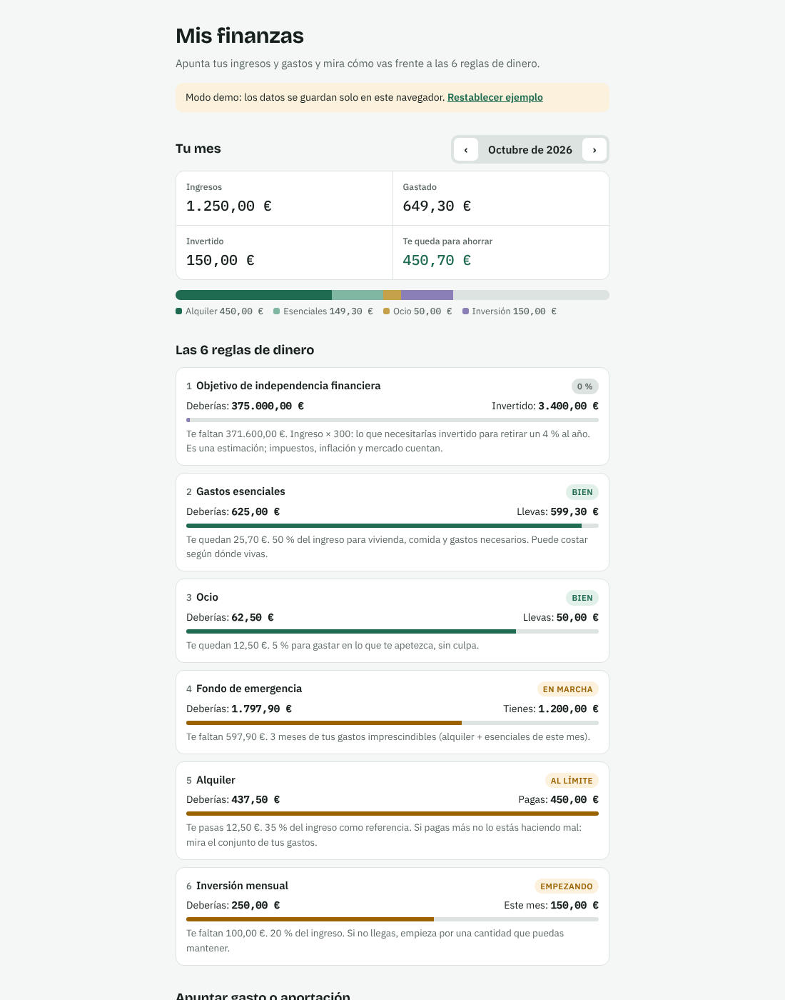

# Gestor de finanzas

Aplicación web para llevar tus finanzas personales y ver, cada mes, cómo vas frente a **6 reglas de dinero**: gastos esenciales, ocio, alquiler, inversión, fondo de emergencia y objetivo de independencia financiera.

Cada persona entra con su correo y solo ve sus propios datos.



## Qué hace

- **Ingresos y gastos fijos** que se repiten cada mes (nómina, alquiler, recibos, suscripciones).
- **Gastos variables y aportaciones a inversión** apuntados día a día, agrupados por mes.
- **Resumen del mes**: ingresos, gastado, invertido y lo que queda para ahorrar, con una barra de reparto por categoría.
- **Las 6 reglas** calculadas sobre tu ingreso, con lo que deberías gastar, lo que llevas y un estado (bien, al límite, te pasas):

| # | Regla | Cálculo |
|---|-------|---------|
| 1 | Objetivo de independencia financiera | Ingreso mensual × 300 (retirada anual del 4 %) |
| 2 | Gastos esenciales | 50 % del ingreso (alquiler + esenciales) |
| 3 | Ocio | 5 % del ingreso |
| 4 | Fondo de emergencia | 3 meses de gastos esenciales |
| 5 | Alquiler | 35 % del ingreso |
| 6 | Inversión mensual | 20 % del ingreso |

Las reglas son una referencia, no un objetivo que haya que cumplir entero: sirven para ver dónde estás y elegir el siguiente paso.

## Stack

- **React 19 + TypeScript** con **Vite**
- **Supabase**: autenticación sin contraseña (enlace mágico) y base de datos Postgres
- **Row Level Security** en Postgres: cada fila pertenece a un usuario y la propia base de datos impide leer o escribir datos ajenos
- **Vitest** para la lógica de negocio
- **GitHub Actions**: lint, tests y build en cada push

## Arquitectura

```
src/
├── domain/        Lógica pura, sin React ni red: tipos, cálculo de las reglas y formato
├── data/          Repositorio con dos implementaciones: Supabase y modo demo (localStorage)
├── hooks/         useFinanzas: carga los datos y expone las operaciones
└── components/    Pantallas y formularios
supabase/
└── migrations/    Esquema SQL con las políticas de seguridad
```

Algunas decisiones:

- **Las reglas viven en `src/domain/reglas.ts` como funciones puras.** Así se testean sin navegador ni base de datos, y los porcentajes están en un único sitio.
- **Patrón repositorio.** La interfaz no sabe dónde se guardan los datos. Sin variables de entorno la app arranca en **modo demo** con datos de ejemplo en el navegador, lo que permite probarla sin crear cuenta.
- **La seguridad está en la base de datos, no en el cliente.** Las políticas RLS comprueban `auth.uid() = user_id`, y las restricciones `check` validan importes, categorías y que cada tipo de movimiento tenga los campos que le corresponden.
- **Importes en formato español.** `parsearImporte` entiende `1.250`, `12,50` y `1.250,75 €`, y todo se redondea a céntimos para evitar errores de coma flotante.

## Ponerlo en marcha

Requisitos: Node 22.

```bash
npm install
npm run dev
```

Sin más configuración arranca en modo demo.

### Con Supabase

1. Crea un proyecto en [supabase.com](https://supabase.com).
2. En el editor SQL, ejecuta `supabase/migrations/20261017000000_inicial.sql`.
3. En **Authentication → URL Configuration**, añade la URL de tu app (por ejemplo `http://localhost:5173`) a las URLs de redirección.
4. Copia `.env.example` a `.env.local` y rellena la URL y la clave `anon` del proyecto (Project Settings → API).
5. `npm run dev` y entra con tu correo.

### Desplegar

Funciona en cualquier hosting estático (Vercel, Netlify, Cloudflare Pages). Configura las dos variables `VITE_SUPABASE_*` en el hosting y añade la URL de producción a las redirecciones de Supabase.

## Scripts

| Comando | Qué hace |
|---------|----------|
| `npm run dev` | Servidor de desarrollo |
| `npm test` | Tests con Vitest |
| `npm run lint` | ESLint |
| `npm run build` | Comprobación de tipos y build de producción |

## Licencia

MIT
